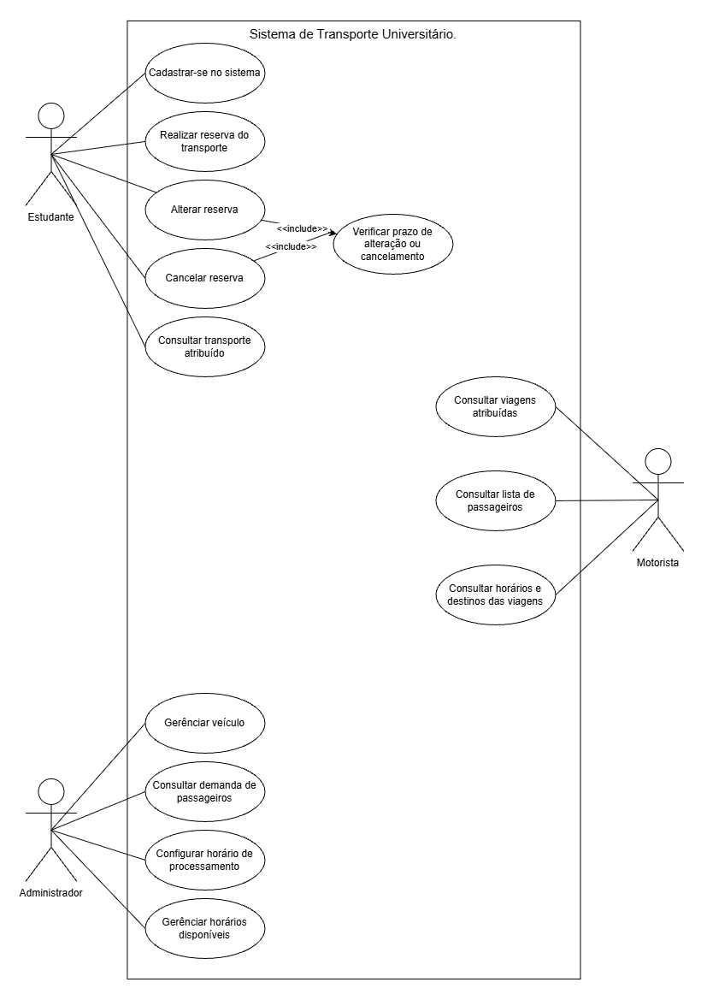
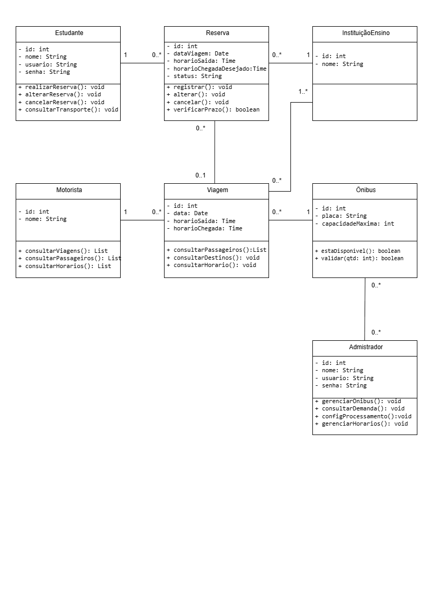

# SISTEMA
## 4.MODELAGEM
### 4.1.DIAGRAMA DE CASOS DE USO

### 4.2 Especificação do Caso de Uso

### UC01. Realizar Reserva de Transporte

Ator principal: Estudante.

Objetivo: Permitir que o estudante registre uma solicitação de transporte universitário, informando a data, o horário desejado e a instituição de ensino de destino.

Pré-condições:
 O estudante deve estar cadastrado no sistema.
 O estudante deve estar autenticado.

Pós-condições:
 A reserva é registrada no sistema.
 A reserva fica aguardando o processamento automático para a distribuição dos passageiros entre os ônibus disponíveis.

Fluxo principal:

1. O estudante acessa o sistema.
2. O estudante seleciona a opção "Realizar reserva de transporte".
3. O sistema apresenta o formulário de reserva.
4. O estudante informa a data da viagem.
5. O estudante seleciona o horário desejado de transporte.
6. O estudante seleciona a instituição de ensino de destino.
7. O estudante confirma as informações.
8. O sistema valida os dados informados.
9. O sistema registra a reserva e apresenta uma mensagem de confirmação.

**Fluxos alternativos e de exceção:**

   1. Caso o estudante informe um horário ou destino inválido, o sistema apresenta uma mensagem de erro e solicita a correção.
   2. O sistema impede a confirmação da reserva até que todas as informações obrigatórias sejam preenchidas.
   3. Caso ocorra um erro durante o armazenamento, o sistema informa que a reserva não foi concluída.

Requisitos relacionados: RF02, RF03, RF04, RF05, RF09 e RF10.

Regras de negócio relacionadas: RN02 e RN03.

### 4.3 DIAGRAMA DE CLASSES

### 4.4 RASTREABILIDADE DOS MODELOS

| Requisito funcional | Caso de uso correspondente | Classes relacionadas | Regras de negócio |
|---|---|---|---|
| RF01 — Cadastro de passageiros | Cadastrar-se no sistema | Estudante | RN01 |
| RF02 — Login com usuário e senha | Não representado no diagrama; autenticação é pré-condição de UC01. | Estudante (usuario, senha) | Sem RN específica; RN01 é pré-requisito. |
| RF03 — Dias da semana | UC01 — Realizar Reserva de Transporte¹ | Estudante; Reserva (dataViagem) | RN02 |
| RF04 — Horários de saída e chegada | UC01 — Realizar Reserva de Transporte | Reserva | RN03 |
| RF05 — Seleção da instituição de ensino | UC01 — Realizar Reserva de Transporte | Reserva; InstituiçãoEnsino | RN03 |
| RF06 — Alteração ou cancelamento | Alterar reserva; Cancelar reserva; Verificar prazo de alteração ou cancelamento | Estudante; Reserva | RN09 |
| RF07 — Cadastro e gestão de ônibus | Gerenciar veículo | Administrador; Ônibus | RN10 |
| RF08 — Capacidade máxima do ônibus | Gerenciar veículo | Ônibus (capacidadeMaxima); Administrador | RN05; RN10 |
| RF09 — Quantidade por horário e destino | Consultar demanda de passageiros (consulta; cálculo não explicitado) | Administrador; Reserva; Viagem; InstituiçãoEnsino | RN04; RN06 |
| RF10 — Distribuição dos passageiros | Sem caso específico; Configurar horário de processamento dá suporte ao agendamento. | Reserva; Viagem; Ônibus; InstituiçãoEnsino; Administrador | RN04; RN05; RN06; RN07 |
| RF11 — Resultado da organização | Consultar transporte atribuído | Estudante; Reserva; Viagem | RN08 |
| RF12 — Ônibus, horário e destino | Consultar transporte atribuído | Estudante; Reserva; Viagem; Ônibus; InstituiçãoEnsino | RN08 |

