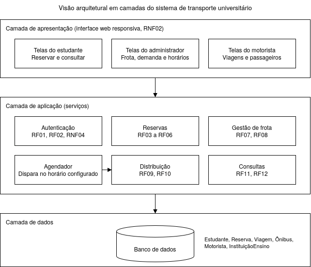
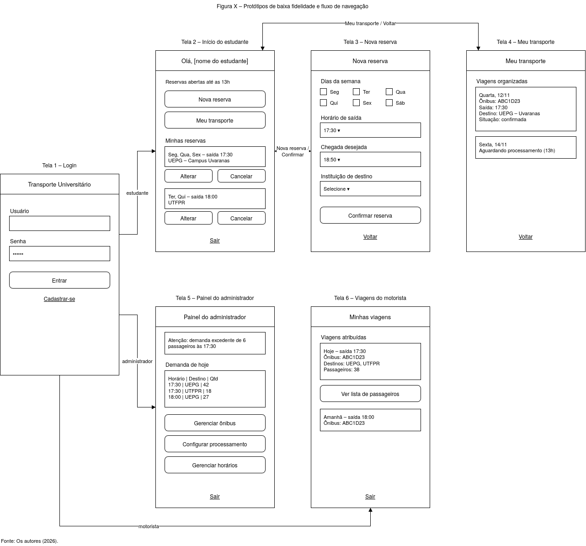

# 5. Projeto e Arquitetura

Esta seção descreve como o sistema será estruturado para atender aos requisitos levantados: a arquitetura em camadas, os princípios de projeto aplicados, a análise de coesão e acoplamento, o refinamento de uma funcionalidade e os protótipos de tela. As decisões são independentes de linguagem de programação ou tecnologia específica.

## 5.1 Visão arquitetural em alto nível

O sistema adota uma arquitetura em três camadas (apresentação, aplicação e dados), representada na figura abaixo.



A regra principal é que cada camada se comunica **somente com as camadas imediatamente acima e abaixo dela**: as solicitações descem e as respostas sobem pelo mesmo caminho. Assim, a interface nunca acessa o banco de dados diretamente, e tudo passa pelas regras da camada de aplicação.

A camada de apresentação é uma interface web responsiva (RNF02), com visões para estudante, administrador e motorista. Ela apenas exibe informações e captura as ações do usuário. A camada de dados armazena as entidades do diagrama de classes (seção 4.3) e apenas responde às solicitações da aplicação. Já a camada de aplicação concentra as regras de negócio, divididas em seis serviços:

- *Autenticação*: login e permissões de acesso.
- *Reservas*: registra, altera e cancela solicitações dentro do prazo (RN09).
- *Gestão de frota*: cadastro dos ônibus e de suas capacidades.
- *Distribuição*: aloca os passageiros respeitando a capacidade dos veículos (RN05) e alerta o administrador sobre demanda excedente (RN07).
- *Consultas*: entrega os resultados a estudantes e motoristas.
- *Agendador*: dispara a Distribuição no horário configurado, sem ação do usuário.

Serviços da mesma camada podem se comunicar entre si, como o Agendador acionando a Distribuição. O fluxo principal do sistema é:

1. O estudante faz a reserva pela interface, que a envia ao serviço de Reservas. Este valida os dados (RN03) e os grava na camada de dados.
2. No horário configurado, o Agendador aciona a Distribuição.
3. A Distribuição lê as reservas e os ônibus da camada de dados, aloca os passageiros e grava as viagens geradas.
4. Estudante e motorista consultam o resultado pelo serviço de Consultas.

## 5.2 Justificativa das decisões arquiteturais

O projeto segue quatro princípios fundamentais da Engenharia de Software:

**Abstração.** Cada nível do sistema mostra apenas o que é relevante: na arquitetura, as três camadas; nos serviços, o que cada um faz, e não como faz. A Distribuição, por exemplo, trabalha apenas com reservas que têm horário e destino, sem depender de como foram coletadas. É isso que permite trocar as mensagens de WhatsApp por dados uniformes, processados automaticamente.

**Modularidade.** A camada de aplicação é dividida em seis módulos independentes, cada um ligado a um grupo de requisitos. Assim, o algoritmo de distribuição pode ser alterado sem mexer no cadastro de reservas, o que atende ao RNF08.

**Separação de interesses.** Cada parte trata de uma única preocupação: a interface exibe, a aplicação aplica as regras e os dados armazenam. Por isso, a RN05 é implementada em um só lugar, e não repetida em cada tela. Da mesma forma, o Agendador decide quando processar, e a Distribuição decide como alocar.

**Encapsulamento.** Os atributos das classes são privados e só podem ser acessados por meio de operações. A `capacidadeMaxima` do Ônibus só é verificada por `validar(qtd)`, o que garante a RN05. O prazo da RN09 fica em `verificarPrazo()`, da classe Reserva, e a senha dos usuários não é acessível externamente (RNF03, RNF04).

## 5.3 Análise de coesão e acoplamento

A coesão indica o quanto um componente se dedica a um único propósito, e o ideal é que seja alta. O acoplamento indica o quanto um componente depende de outros, e o ideal é que seja baixo.

**Coesão alta: serviço de Distribuição.** Todas as suas tarefas servem a um único objetivo, que é alocar passageiros nos veículos (RF09, RF10, RN05, RN06, RN07). Por isso, ele pode ser testado isoladamente, recebendo apenas reservas e ônibus como entrada.

**Coesão baixa: classe Administrador.** Reúne as operações `gerenciarOnibus()`, `consultarDemanda()`, `configProcessamento()` e `gerenciarHorarios()`, que são responsabilidades distintas, agrupadas apenas por pertencerem ao mesmo ator. A correção é proposta na seção 5.4.

**Acoplamento baixo: Agendador e Distribuição.** O Agendador apenas solicita a execução no horário configurado, sem trocar dados nem conhecer o algoritmo. Mudar o horário não afeta o algoritmo, e mudar o algoritmo não afeta o horário.

**Acoplamento necessário: Distribuição, Reserva e Ônibus.** A Distribuição precisa dos dados de reservas e ônibus, mas acessa a capacidade apenas por `validar(qtd)`. Se a regra de capacidade mudar, só a classe Ônibus é alterada. Como ponto de atenção, Reservas, Distribuição e Consultas compartilham a mesma base de dados, então mudanças na entidade Reserva exigem análise de impacto.

## 5.4 Refinamento de funcionalidade e proposta de refatoração

### Refinamento do RF10

O refinamento detalha uma funcionalidade aos poucos, partindo do requisito até chegar a passos que possam ser implementados. Foi escolhido o RF10 (distribuir os passageiros respeitando a capacidade dos ônibus), por ser a funcionalidade central do sistema. Ele é executado pelo serviço de Distribuição, acionado pelo Agendador, nos seguintes passos:

1. Encerrar o recebimento de reservas. A partir daí, alterações e cancelamentos ficam bloqueados (RN09).
2. Agrupar as reservas por data e horário de saída e ordená-las por instituição de destino (RN06).
3. Alocar os passageiros nos ônibus disponíveis, verificando a capacidade com `validar(qtd)` (RN05).
4. Marcar como excedentes as reservas sem vaga e notificar o administrador (RN07).
5. Registrar as viagens geradas, que ficam disponíveis para consulta (RF11, RF12, RN08).

Conforme observado no funcionamento atual do transporte, um mesmo ônibus atende mais de uma instituição em uma viagem, o que é coerente com a multiplicidade entre Viagem e InstituiçãoEnsino no diagrama de classes. O passo 3 é detalhado no pseudocódigo abaixo:

```
PARA cada grupo (data, horarioSaida):
    reservas ← reservas do grupo, ordenadas por instituição
    frota    ← ônibus disponíveis, ordenados por capacidade (maior primeiro)
    i ← 0
    viagem ← nova Viagem(frota[i])
    ocupacao ← 0

    PARA cada reserva r em reservas:
        ENQUANTO NÃO frota[i].validar(ocupacao + 1) E existe frota[i + 1]:
            i ← i + 1
            viagem ← nova Viagem(frota[i])
            ocupacao ← 0
        SE frota[i].validar(ocupacao + 1):
            associar r a viagem
            ocupacao ← ocupacao + 1
        SENÃO:
            marcar r como excedente

    SE houver excedentes:
        notificar administrador          // RN07
```

Cada linha do algoritmo corresponde a uma regra de negócio ou a uma operação já prevista no diagrama de classes.

### Proposta de refatoração futura

Refatorar é melhorar a estrutura interna do software sem alterar seu comportamento externo. Propõe-se dividir as operações do Administrador, que tem coesão baixa (seção 5.3), em três classes especializadas. O Administrador manteria apenas seus dados de identificação e acesso.

| Antes (na classe Administrador) | Depois (nova classe) |
|---|---|
| `gerenciarOnibus()` | `GestaoFrota`: cadastrar, alterar e remover ônibus |
| `configProcessamento()`, `gerenciarHorarios()` | `ConfiguracaoAgendamento`: horário de processamento e horários de viagem disponíveis |
| `consultarDemanda()` | `RelatorioDemanda`: cálculo e exibição da demanda por horário e destino |

Para o usuário, nada muda. Internamente, cada classe passa a ter um único propósito, pode ser testada separadamente e pode evoluir sem afetar as demais.

## 5.5 Protótipo de telas e fluxo de navegação

Os protótipos abaixo são de baixa fidelidade: mostram a disposição das informações e das ações, sem definir a aparência final. Foram desenhados em formato de celular, que é o principal meio de acesso esperado (RNF02).



- **Tela 1 – Login.** Usuário e senha (RF02, RNF04) ou cadastro (RF01). O sistema identifica o perfil e direciona o usuário à tela correspondente.
- **Tela 2 – Início do estudante.** Mostra o prazo de reserva (RN09) e as reservas ativas, que podem ser alteradas ou canceladas (RF06).
- **Tela 3 – Nova reserva.** Corresponde ao UC01: dias da semana, horários e instituição de destino (RF03 a RF05), com validação e mensagens de erro claras (RN03, RNF07).
- **Tela 4 – Meu transporte.** Exibe o ônibus, o horário, o destino e a situação de cada viagem (RF11, RF12).
- **Tela 5 – Painel do administrador.** Mostra a demanda por horário e destino (RF09), o alerta de demanda excedente (RN07) e o acesso à gestão de ônibus e horários (RF07, RF08).
- **Tela 6 – Viagens do motorista.** Lista as viagens atribuídas, com horário, ônibus, destinos e lista de passageiros.

**Fluxo de navegação.** Todos os usuários começam pelo login e são direcionados conforme o perfil: o estudante vai à Tela 2, de onde acessa as Telas 3 e 4; o administrador vai à Tela 5; e o motorista, à Tela 6. Cada perfil só acessa as próprias telas (RNF04), e a navegação tem no máximo dois níveis, o que mantém a interface simples (RNF01).
