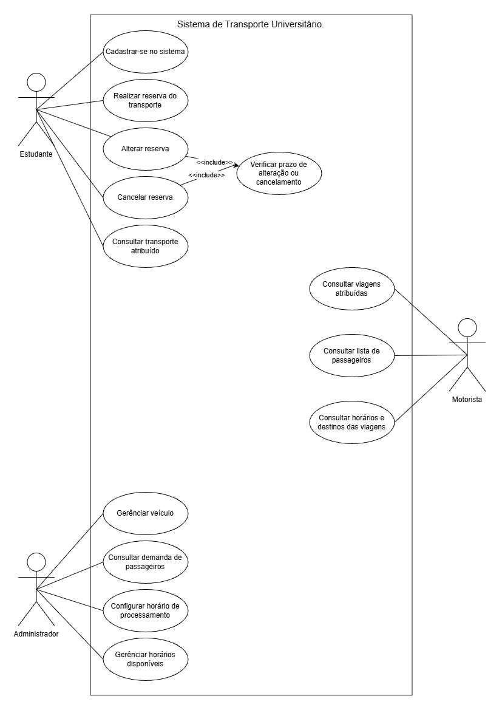
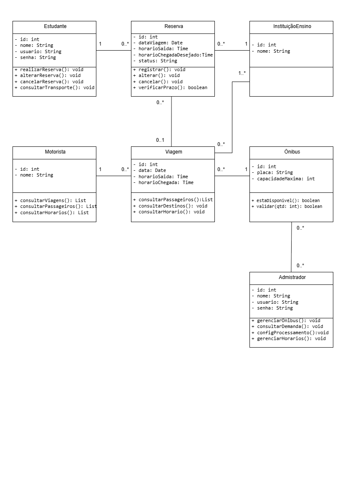

# SISTEMA
## 4.MODELAGEM
### 4.1.DIAGRAMA DE CASOS DE USO

### 4.2 Especificação do Caso de Uso

### UC01. Realizar Reserva de Transporte

Ator principal: Estudante.

Objetivo: Permitir que o estudante registre uma solicitação de transporte universitário, informando a data, o horário desejado e a instituição de ensino de destino.

Pré-condições:
 O estudante deve estar cadastrado no sistema.
 O estudante deve estar autenticado.

Pós-condições:
 A reserva é registrada no sistema.
 A reserva fica aguardando o processamento automático para a distribuição dos passageiros entre os ônibus disponíveis.

Fluxo principal:

1. O estudante acessa o sistema.
2. O estudante seleciona a opção "Realizar reserva de transporte".
3. O sistema apresenta o formulário de reserva.
4. O estudante informa a data da viagem.
5. O estudante seleciona o horário desejado de transporte.
6. O estudante seleciona a instituição de ensino de destino.
7. O estudante confirma as informações.
8. O sistema valida os dados informados.
9. O sistema registra a reserva e apresenta uma mensagem de confirmação.

**Fluxos alternativos e de exceção:**

   1. Caso o estudante informe um horário ou destino inválido, o sistema apresenta uma mensagem de erro e solicita a correção.
   2. O sistema impede a confirmação da reserva até que todas as informações obrigatórias sejam preenchidas.
   3. Caso ocorra um erro durante o armazenamento, o sistema informa que a reserva não foi concluída.

Requisitos relacionados: RF02, RF03, RF04, RF05, RF09 e RF10.

Regras de negócio relacionadas: RN02 e RN03.

### 4.3 DIAGRAMA DE CLASSES

